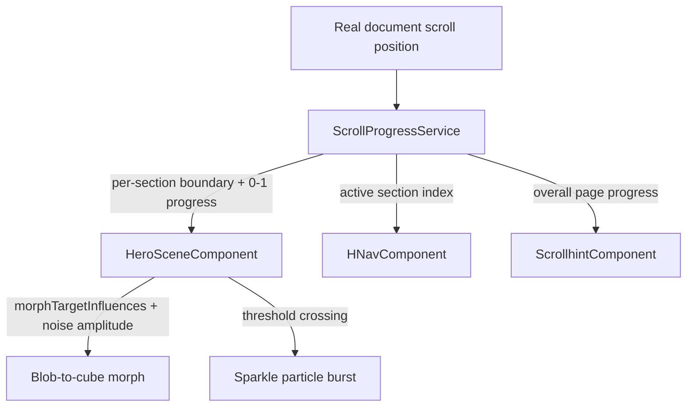
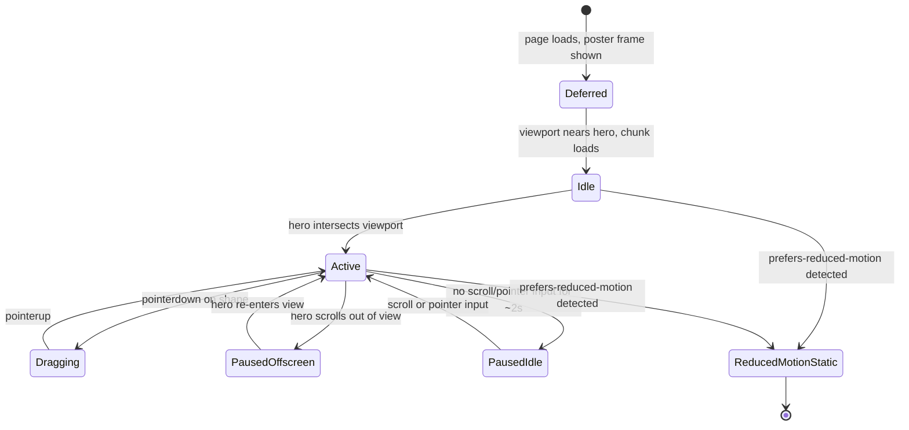

# 3D Morph Hero Visual - Plan

## Goal Capsule

- **Objective:** Build an original 3D morphing hero visual (blob shape that morphs into a cube, with a sparkle flourish) plus a royalty-free "Press Play" music toggle, replacing the current scroll-driven hero on thomastritscher.de. Delivering this requires converting the homepage off its wheel/touch-counter carousel onto real scroll-based navigation.
- **Product authority:** Site owner (Thomas Tritscher), decisions confirmed through brainstorm dialogue on 2026-08-24 and planning dialogue on 2026-08-24.
- **Stop conditions:** None currently blocking. Track sourcing/licensing for Press Play is an open, non-blocking to-do (see Outstanding Questions) — implementation can proceed with placeholder/mock audio and the real tracks dropped in before ship.
- **Execution profile:** Standard implementation plan; `code`.
- **Tail ownership:** Not part of an autonomous pipeline run; the implementer (human or `ce-work`) owns commit/PR/ship decisions.

## Product Contract

### Summary

Replace the current hero's curtain-reveal scroll section with an original, scroll- and drag-driven 3D visual: an organic blob shape that morphs into a cube as the visitor scrolls, finishing with a sparkle flourish, pinned to the hero region only. Add a "Press Play" toggle that plays royalty-free background music.

### Problem Frame

The current hero (`src/app/sections/sections.component.html`) opens with a plain scroll-driven curtain reveal — background images cross-fading behind text, driven by manual `[ngStyle]` transform/opacity bindings. It has no distinctive motion signature, and the app has no 3D rendering capability anywhere today. The idea originated from runrobrun.com's portfolio, whose opening is anchored by a scroll- and pointer-driven 3D morphing scene that gives that site an immediate, memorable identity moment.

### Key Decisions

- **Original implementation only — no code, shader/scene assets, lighting setup, or songs are reused from the reference site.** The reference site's build and its curated tracks are its own copyrighted work; this project rebuilds the *behavior*, not the artifact. (session-settled: user-approved — chosen over reusing reference-site files: avoids reproducing another site's copyrighted code and content.) Governs R1, R7.
- **Lighter sparkle mechanism over a literal multi-hundred-piece shard explosion.** Keeps the same visual beat (cube "sparkles") without animating hundreds of live mesh instances every frame. (session-settled: user-directed — chosen over a full-fidelity shard-explosion rebuild: needed to realistically hit full desktop + mobile performance parity.) Governs R3.
- **Replaces the existing hero scroll mechanic outright, rather than layering alongside it.** Avoids running two different scroll-jacking systems back to back. (session-settled: user-directed — chosen over inserting the 3D block as an additional step before the untouched existing hero.) Governs R5, R6.
- **Hero-scoped placement, not a persistent full-page background.** The visual is pinned during the hero only, then scrolls away as later sections take over — matching the reference site's actual behavior rather than running behind the whole page. (session-settled: user-directed.) Governs R5.
- **Full device parity required for v1 — no reduced mobile fallback.** The morph, drag-rotate, sparkle, and music toggle must all work the same on desktop and mobile/touch. (session-settled: user-directed — chosen over a simplified mobile version.) Governs R8.
- **Drag interaction is scoped to rotation only, not shape deformation.** The visitor can spin the shape by dragging; dragging does not squish or otherwise deform its geometry. (session-settled: user-approved — proposed as the default scope, confirmed without objection.) Governs R4.
- **Press Play offers a small curated set of 2–4 tracks, not a single loop or an open-ended playlist.** (session-settled: user-directed — chosen over a single ambient loop or a user-supplied list of unknown size.) Governs R7.
- **Full real-scroll conversion of the homepage, not a hero-only hybrid.** The homepage today has no real scrolling — `MainComponent` is a fixed-viewport carousel driven by a wheel/touch counter, which also drives nav highlighting (`HNavComponent`) and the scroll-progress hint bar (`ScrollhintComponent`). All of it moves onto real scroll position alongside the hero, rather than leaving sections 2–5 on the counter model. (session-settled: user-directed — chosen over hero-only real scroll or driving the morph from gesture delta: needed for a continuous scroll-scrubbed morph, accepted the wider blast radius on nav/hint components.) Governs R6.

### Requirements

**Visual & morph behavior**

- R1. The hero renders an original 3D scene showing a single deformable "blob" shape, built without reusing the reference site's code, shaders, or 3D assets.
- R2. Scroll progress through the hero drives the shape's morph, from the organic blob form to a cube form.
- R3. Past a scroll threshold, the cube produces a "sparkle" visual flourish marking the completion of the morph, using a lighter-weight technique (e.g. particles or an emissive glow) rather than a literal multi-hundred-piece explosion.

**Interaction**

- R4. Visitors can click-and-drag (or touch-and-drag) the shape to rotate it manually, in addition to its idle and scroll-driven motion; dragging rotates the shape only and does not change its morph state.

**Placement & scroll integration**

- R5. The 3D visual is pinned within the hero section only — not a persistent full-page background — and scrolls away once the visitor passes the hero.
- R6. The 3D hero entirely replaces the existing section-1 image-curtain/z-index reveal. The homepage moves from its current fixed-viewport wheel/touch-counter navigation to real scroll-based navigation; sections after the hero, nav highlighting, and the scroll-progress hint bar preserve their existing visual behavior under the new scroll mechanism.

**Music**

- R7. The site includes a "Press Play" control offering a small curated set (2–4) of licensed or royalty-free tracks (not the reference site's songs) that the visitor can start and stop.

**Performance & device support**

- R8. The full experience (morph, drag-rotate, sparkle, and music toggle) performs acceptably on both desktop and mobile/touch devices for v1 — no reduced-feature mobile fallback.

### Key Flows

- F1. Hero scroll-morph journey
  - **Trigger:** Visitor loads the homepage and begins scrolling.
  - **Steps:** Blob shape idles → visitor scrolls through the hero track → shape morphs toward a cube in step with scroll progress → visitor may drag at any point to rotate it → sparkle flourish plays near the end of the track → hero unpins → the next section begins under real-scroll navigation.
  - **Outcome:** A single continuous opening experience that replaces the old hero, leading into the rest of the page now navigated by real scroll.
  - **Covers:** R1, R2, R3, R4, R5, R6.
- F2. Press Play music toggle
  - **Trigger:** Visitor clicks/taps the Press Play control.
  - **Steps:** Control toggles playback of a royalty-free track; its visual state reflects playing/paused.
  - **Outcome:** Ambient music is available without being forced on visitors by default.
  - **Covers:** R7.

### Acceptance Examples

- AE1. **Covers R2, R3.** Given a visitor scrolls from the top of the hero to the bottom of the hero track, when scroll progress passes the midpoint, then the shape visibly transitions from blob toward cube form; when scroll progress crosses the split threshold, then the sparkle flourish plays on the cube.
- AE2. **Covers R4.** Given a visitor presses and drags on the shape, when they move the pointer, then the shape rotates to track the drag without altering its morph state; when they release, then it resumes idle motion from its current rotation.
- AE3. **Covers R6.** Given a visitor scrolls past the hero, when they reach the next section's content, then the remaining sections' reveal behavior, nav highlighting, and scroll-progress hint bar continue to reflect the visitor's position accurately, now driven by real scroll position instead of the wheel/touch counter.
- AE4. **Covers R7.** Given a visitor clicks "Press Play", when music starts, then one of the curated royalty-free tracks plays and the control reflects a "playing" state; clicking again stops playback.

### Scope Boundaries

- The reference site's actual code, 3D scene/shader modules, lighting assets, or exact song list — out of scope entirely; everything is rebuilt or re-sourced as original work.
- A literal multi-hundred-instance shard-explosion mechanic — replaced by a lighter sparkle technique (see Key Decisions).
- A persistent full-page 3D background running behind every section — out of scope; hero-scoped only.
- A reduced/simplified mobile experience — out of scope; full parity is required for v1.

**Deferred to Follow-Up Work:**

- Removing the unused `ScrollBarComponent` (declared in `AppModule`, never referenced in any template) — dead code found during planning research, unrelated to this feature.
- Adaptive GPU-tier quality scaling (e.g. `detect-gpu`-driven quality slider) — the scene's polygon/particle budget already sits well inside mobile limits (see KTD7), so this isn't needed for v1. Revisit only if real-device testing shows otherwise.

### Dependencies / Assumptions

- No 3D rendering capability exists in this app today (`package.json` has no WebGL/3D library); this work introduces one.
- The 2–4 royalty-free tracks for Press Play are not yet sourced or license-cleared; sourcing and rights confirmation happen before this ships (see Outstanding Questions).

### Outstanding Questions

- **Deferred to Planning:** Source 2–4 royalty-free/licensed tracks and confirm their usage rights cover this use (e.g. commercial/portfolio use) before the feature ships — does not block writing the implementation plan.

### Sources / Research

- Current hero markup: `src/app/sections/sections.component.html` — section 1 (image curtain reveal) is what this work replaces; section 2 ("portfolio 2026" / name title) is unaffected in content, though its reveal mechanism moves to real scroll.
- No 3D/WebGL rendering library is present in `package.json` today.
- Reference behavior observed on runrobrun.com's public hero (scroll-driven morph, drag-rotate, cube-split-into-shards) informed these requirements; no code or assets from that site were reused.
- Repo research found the homepage (`src/app/main/main.component.ts`) has no real scrolling today — a fixed-viewport carousel driven by a hand-rolled wheel/touch counter (`LayerChangeService`), which also drives `HNavComponent` (nav highlighting) and `ScrollhintComponent` (scroll-progress hint bar). This is why R6 now includes converting the homepage to real scroll-based navigation.

---

## Planning Contract

**Product Contract preservation:** changed: R6 — the homepage's scroll model did not support "scroll progress"/"pinned until scrolled past" as originally written, since no real scrolling exists on the route today. Planning research surfaced this, and the user confirmed a full real-scroll conversion of the homepage (not hero-only) rather than a hybrid or gesture-delta approach. R6, its Key Decision, F1's outcome, AE3, and Scope did not change in intent, only in stated mechanism.

### Key Technical Decisions

- KTD1. **Use `three` (`THREE.WebGLRenderer`, not `WebGPURenderer`), pinned to an exact version (r185 / `0.185.x` at time of writing).** Mobile WebGPU coverage is still uneven in 2026 (older iOS, Firefox Android) and this scene has no workload that needs WebGPU's advantages. `WebGLRenderer` is the maximally compatible choice for a hard full-parity requirement. Governs R1, R8.
- KTD2. **Morph the blob into a cube using Three.js morph targets (cube-projected-to-sphere vertex correspondence), layered with a GPU noise-displacement vertex shader for the organic wobble, scaled by `(1 - progress)`.** Morph targets are GPU-interpolated (a single scalar per frame drives the blend), ideal for scroll-scrubbing; the noise layer vanishes as the cube form completes. Governs R1, R2.
- KTD3. **Sparkle via a single `THREE.Points` particle burst (additive blending, sprite texture, a few hundred points, short-lived scale/opacity curve), not `UnrealBloomPass` postprocessing or a literal shard explosion.** One draw call, no full-screen multi-pass blur — materially cheaper on mid-range mobile GPUs than bloom, and matches "lightweight flourish" directly. (session-settled: user-directed — chosen over a full-fidelity shard-explosion rebuild: needed to realistically hit full desktop + mobile performance parity.) Governs R3.
- KTD4. **Drag-to-rotate via raw Pointer Events (`pointerdown`/`pointermove`/`pointerup`/`pointercancel`) mutating `mesh.rotation` directly, listened on `window` during an active drag.** No `OrbitControls` (orbits a camera, not a single mesh) or `DragControls` (translates objects) — those don't fit "rotate one mesh in place." Governs R4.
- KTD5. **A shared `ScrollProgressService` replaces `LayerChangeService`'s wheel/touch-counter-mutated fields as the single scroll-position source for the hero, `HNavComponent`, and `ScrollhintComponent`.** Computed once per animation frame (not per raw scroll event) via `IntersectionObserver` for per-section boundaries plus `getBoundingClientRect()` for continuous within-section progress. (session-settled: user-directed — chosen over hero-only real scroll or driving the morph from gesture delta: needed for a continuous scroll-scrubbed morph, accepted the wider blast radius on nav/hint components.) Governs R6.
- KTD6. **The render loop runs via `renderer.setAnimationLoop()` inside `NgZone.runOutsideAngular`.** This app is zone-based (`provideZoneChangeDetection()` in `src/main.ts`, zone.js in `src/polyfills.ts`), not zoneless, so without this every rendered frame would trigger Angular change detection. Full disposal (geometries, materials, textures, renderer) plus `webglcontextlost`/`webglcontextrestored` handling happens in `ngOnDestroy` — iOS Safari has a known history of WebGL context loss under memory pressure or backgrounding. Governs R1, R8.
- KTD7. **Reduced motion, idle, and off-screen pausing are built in, not deferred.** `prefers-reduced-motion: reduce` freezes on a static frame and disables scroll-pin/drag; `IntersectionObserver` stops the render loop entirely when the hero scrolls out of view (`cancelAnimationFrame`/`setAnimationLoop(null)`, not just skipping `render()`); an idle timeout (~2s with no scroll/pointer activity) drops to a single rendered frame. `devicePixelRatio` is capped at 2, no shadow maps, mesh stays in the 50k–100k triangle range. These are the mechanisms that make "full parity, no reduced fallback" (R8) achievable on real mobile hardware rather than just claimed. Governs R8.
- KTD8. **The hero scene module is lazy-loaded (Angular `@defer (on viewport)`) behind a lightweight static poster-frame placeholder**, keeping Three.js out of the initial bundle/LCP path. The poster frame doubles as the reduced-motion static frame from KTD7. Governs R1, R8.
- KTD9. **Press Play is a new `AudioPlaybackService` (`providedIn: 'root'`, matching the existing `LayerChangeService`/`TransformBGService` singleton-service convention) wrapping `HTMLAudioElement`, with playback only ever started synchronously inside a click handler.** Never autoplay — browser autoplay policy blocks it anyway, and autoplaying audio on a portfolio site is poor UX regardless. Governs R7.

### High-Level Technical Design

**Data flow: scroll position to its three consumers.**

**Hero render-loop lifecycle (state machine).**

### Assumptions

- The exact `three` version pinned at implementation time may differ from r185 if a newer patch has shipped; pin whatever is current and record it in `package.json`.
- `HNavComponent` and `ScrollhintComponent`'s existing visual design (what the nav indicator and hint bar look like) stays as-is; only their data source changes from counter-driven to scroll-driven.
- Actual royalty-free track files are not yet available; U7 is built and tested against placeholder/mock audio, with real files dropped into `src/assets/audio/` before ship (see Outstanding Question above).

### Sequencing

Phase 1 (U1, U2) must land before Phase 2 (U3–U6), since the hero scene needs a real, pinned scroll container to mount into and a working `ScrollProgressService` to read from. Phase 3 (U7) has no dependency on the other two and can be built in parallel with either phase.

### System-Wide Impact

- **`OuterFrameComponent`** (nav bar, hamburger menu) is a fixed-position overlay with no dependency on `LayerChangeService` or the hero (per repo research). It should keep working unmodified once the page scrolls underneath it, since `position: fixed` is relative to the viewport, not document flow — but this is an assumption to spot-check in U1's manual verification, not a certainty.
- **`LayerChangeService`** loses its hero-specific fields (U2) and its wheel/touch-counter mutation entirely (U1). Any other consumer of this service beyond `HNavComponent`/`ScrollhintComponent`/`SectionsComponent` would break silently; repo research found none, but U1/U2 verification should re-confirm via a repo-wide reference check before removing fields.
- **`ContactComponent`** independently reimplements the same wheel/touch/counter pattern (per repo research) but is out of scope — it is not touched by this plan and keeps working exactly as it does today, since it does not depend on `MainComponent` or `LayerChangeService`'s hero fields.
- **Bundle size / LCP**: adding `three` is the first 3D dependency in this app; KTD8's lazy-load keeps it off the critical path, but the production build (Verification Contract) should be checked for a reasonable lazy-chunk size, not just a successful build.
- **Performance posture**: this is the first WebGL/`requestAnimationFrame`-driven surface in the app; KTD6/KTD7 establish the zone-exclusion and pause patterns a future 3D feature in this app should also follow.

### Risks & Dependencies

- **Real-scroll conversion regressions (U1/U2).** The largest architectural change in this plan — replacing a working, if dated, wheel/touch-counter mechanism. Mitigation: land and manually verify U1/U2 across breakpoints before starting the 3D work in U3–U6, so any regression in section-reveal feel is caught early and in isolation.
- **`three` version churn.** Three.js has a history of periodic breaking changes across revisions (per framework research). Mitigation: pin an exact version in `package.json` (KTD1) rather than a loose range, and re-test deliberately on any future upgrade.
- **iOS Safari WebGL context loss.** A recurring, documented issue under memory pressure or backgrounding. Mitigation: KTD6's `webglcontextlost`/`webglcontextrestored` handling and full disposal on `ngOnDestroy`.
- **Browser autoplay policy.** Chrome/Safari block audio playback outside a user gesture. Mitigation: KTD9 starts playback only synchronously inside the click handler; U7's error-path test scenario asserts this directly.
- **Royalty-free track sourcing/licensing is external to this plan** (see Outstanding Questions) — U7 is built and tested against placeholder audio, so this dependency does not block implementation, only shipping.

---

## Implementation Units

### U1. Replace wheel/touch-counter navigation with real scroll

- **Goal:** Remove `MainComponent`'s wheel/touch/counter mechanism and restructure the homepage's fixed-position sections into a normally-flowing (or scroll-snapped) real-scroll layout.
- **Requirements:** R6
- **Dependencies:** none
- **Files:**
  - `src/app/main/main.component.ts`
  - `src/app/main/main.component.html`
  - `src/app/sections/sections.component.ts`
  - `src/app/sections/sections.component.html`
  - `src/app/sections/sections.component.scss`
  - `src/styles.scss` (the `.h` section rule)
  - `src/app/sections/sections.component.spec.ts`
- **Approach:**
  1. Remove the `wheel`/`touchstart`/`touchmove`/`touchend` listeners and the `counter`/debounce timer from `main.component.ts`.
  2. Change the `.h` section layout from `position: fixed` stacking to normal document flow, or `scroll-snap-type: y mandatory` with `scroll-snap-align: start` per section, so each section occupies its own scroll region.
  3. Keep each section's existing visual content; drive their reveal transitions (currently `[ngStyle]`-bound to `LayerChangeService` fields, mutated by wheel events) from `ScrollProgressService` (U2) instead.
- **Patterns to follow:** Keep the component-triplet convention (`.ts`/`.html`/`.scss`/`.spec.ts`) and `providedIn: 'root'` service style already used by `LayerChangeService`.
- **Test scenarios:**
  - Happy path: scrolling the mouse wheel down moves real document scroll position; each section becomes visible in turn.
  - Happy path: a touch swipe on mobile scrolls the page the same way.
  - Edge case: a fast wheel flick does not skip a section's reveal state.
  - Integration: existing reveal transitions (curtain, text fades) still render correctly once driven by scroll position instead of the counter.
- **Verification:** Manual scroll through all 5 sections on a desktop and a mobile-width viewport confirms the same visual sequence as before, now via real scroll.

### U2. Shared `ScrollProgressService` replacing counter-driven nav/hint state

- **Goal:** Introduce a scroll-position-driven service consumed by `HNavComponent`, `ScrollhintComponent`, and the hero scene.
- **Requirements:** R6
- **Dependencies:** U1
- **Files:**
  - `src/app/services/scroll-progress.service.ts` (new)
  - `src/app/services/scroll-progress.service.spec.ts` (new)
  - `src/app/services/layer-change.service.ts`
  - `src/app/h-nav/h-nav.component.ts`
  - `src/app/h-nav/h-nav.component.html`
  - `src/app/scrollhint/scrollhint.component.ts`
  - `src/app/scrollhint/scrollhint.component.html`
- **Approach:** Covers KTD5.
  1. Compute, once per animation frame (batched, not per raw scroll event), the active section index via `IntersectionObserver` per section (mirroring the old 5-step counter model) and a continuous 0–1 within-section progress via `getBoundingClientRect()`.
  2. Point `HNavComponent` and `ScrollhintComponent` at the new service instead of `LayerChangeService`'s `navPoint_text*`/`default_length*`/`runout` fields — same visual output, new data source.
  3. Remove `LayerChangeService`'s hero-specific fields (`z_active`, `o_img_w`, `translateCurtain*`), since U3 replaces that section entirely. Keep the fields it still owns for sections 2–5's reveal, now read from `ScrollProgressService` rather than mutated by wheel events.
- **Test scenarios:**
  - Happy path: scrolling to section 3 updates `HNavComponent`'s active nav indicator to section 3.
  - Happy path: `ScrollhintComponent`'s progress bar reflects overall page-scroll percentage.
  - Edge case: scrolling to the very top or very bottom of the page reports 0%/100% without erroring.
  - Integration: Covers AE3 — nav highlighting and hint bar continue to reflect position accurately under real scroll.
- **Verification:** Unit tests on the boundary/progress calculation against mocked `getBoundingClientRect()` values; manual scroll confirms nav/hint stay in sync.

### U3. Hero scene foundation: component, renderer, lazy-load, lifecycle

- **Goal:** Build `HeroSceneComponent` hosting a `THREE.WebGLRenderer` inside a real-scroll pinned hero block, replacing section 1's image-curtain markup.
- **Requirements:** R1, R5
- **Dependencies:** U1
- **Files:**
  - `src/app/hero-scene/hero-scene.component.ts` (new)
  - `src/app/hero-scene/hero-scene.component.html` (new)
  - `src/app/hero-scene/hero-scene.component.scss` (new)
  - `src/app/hero-scene/hero-scene.component.spec.ts` (new)
  - `src/app/sections/sections.component.html` (swap section-1 markup for the hero block)
  - `src/app/app.module.ts` (declare the new component)
  - `package.json` (add `three` as a pinned-version dependency)
- **Approach:** Covers KTD1, KTD6, KTD8.
  1. Markup: an outer tall wrapper (e.g. `height: 300vh`) containing a `position: sticky; top: 0; height: 100vh` inner block holding `<canvas>`.
  2. `ngAfterViewInit`: create the renderer/scene/camera inside `NgZone.runOutsideAngular`; drive the loop with `renderer.setAnimationLoop()`.
  3. `ngOnDestroy`: stop the loop, dispose geometries/materials/textures/renderer, remove listeners.
  4. Wrap the component in Angular `@defer (on viewport)`, with a lightweight static poster-frame placeholder shown until the chunk loads.
- **Patterns to follow:** Declare in `app.module.ts` like every other component in this app (NgModule-based, not standalone).
- **Test scenarios:**
  - Happy path: the hero canvas mounts and starts rendering once scrolled into view.
  - Integration: the `@defer` placeholder renders synchronously; the live scene swaps in once the chunk loads, without a layout shift.
  - Error path: a `webglcontextlost` event is handled without leaving a blank/broken canvas.
  - Test expectation: rendering correctness itself is not asserted by Jasmine/Karma — covered by manual/browser verification instead (see the plan's confirmed test-scope call-out).
- **Verification:** Manual check in desktop Chrome/Safari and iOS Safari/Android Chrome that the canvas mounts, renders, and disposes cleanly on navigation away.

### U4. Scroll-driven blob-to-cube morph and sparkle flourish

- **Goal:** Wire scroll progress into the morph and trigger the sparkle burst.
- **Requirements:** R2, R3, R8
- **Dependencies:** U2, U3
- **Files:**
  - `src/app/hero-scene/hero-scene.component.ts`
  - `src/app/hero-scene/blob-geometry.ts` (new)
  - `src/app/hero-scene/sparkle-particles.ts` (new)
  - `src/app/hero-scene/blob-geometry.spec.ts` (new)
- **Approach:** Covers KTD2, KTD3, KTD7 (mesh/DPR budget).
  1. Build cube-projected-to-sphere geometry with matching vertex topology; register as a Three.js morph target pair.
  2. Feed `ScrollProgressService`'s hero-local 0–1 progress into `morphTargetInfluences[0]`, damped/lerped per frame to avoid stutter on jerky scroll input.
  3. Layer a GPU noise-displacement vertex-shader term scaled by `(1 - progress)` for the "blob" wobble, vanishing as the cube form completes.
  4. Trigger the `THREE.Points` sparkle burst once progress crosses the split threshold, one-shot per crossing direction.
  5. Cap `devicePixelRatio` at 2; keep the mesh in the 50k–100k triangle range; no shadow maps.
- **Test scenarios:**
  - Happy path: Covers AE1 — progress at the midpoint shows a visibly blended blob/cube form; crossing the split threshold plays the sparkle burst exactly once per pass.
  - Edge case: rapid back-and-forth scrolling near the threshold does not re-trigger the sparkle burst repeatedly.
  - Edge case: progress at exactly 0 and exactly 1 renders the pure blob and pure cube forms without artifacts.
  - Integration: the noise-wobble amplitude reaches zero exactly at progress = 1.
- **Verification:** Unit tests on the pure-JS progress-to-`morphTargetInfluences`/wobble-amplitude mapping function; manual visual check for the morph and sparkle in-browser.

### U5. Drag-to-rotate interaction

- **Goal:** Let visitors drag the shape to rotate it, independent of morph state.
- **Requirements:** R4
- **Dependencies:** U3
- **Files:**
  - `src/app/hero-scene/hero-scene.component.ts`
  - `src/app/hero-scene/drag-rotate.ts` (new)
  - `src/app/hero-scene/drag-rotate.spec.ts` (new)
- **Approach:** Covers KTD4.
  1. Pointer Events (`pointerdown`/`pointermove`/`pointerup`/`pointercancel`) on the canvas and `window`, so drags continuing past canvas bounds are still tracked.
  2. Convert drag delta to `mesh.rotation.y`/`.x` changes, clamping `.x` to avoid flipping; drag never touches `morphTargetInfluences` or scroll progress.
  3. On release, motion resumes from the dragged rotation, no snap-back.
- **Test scenarios:**
  - Happy path: Covers AE2 — dragging rotates the mesh proportionally to pointer movement; releasing resumes idle motion from the current rotation.
  - Edge case: dragging past the canvas bounds continues to rotate, since the listener is on `window`, not just the canvas.
  - Edge case: a drag gesture does not change `morphTargetInfluences` or the scroll-driven progress value.
  - Integration: touch-drag on mobile produces the same rotation behavior as mouse-drag on desktop.
- **Verification:** Unit tests on the pointer-delta-to-rotation-delta math; manual check on touch and mouse.

### U6. Reduced motion, idle-pause, and off-screen pause

- **Goal:** Add the accessibility and battery/performance safeguards that make full desktop+mobile parity achievable.
- **Requirements:** R8
- **Dependencies:** U3, U4, U5
- **Files:**
  - `src/app/hero-scene/hero-scene.component.ts`
  - `src/app/hero-scene/hero-scene.component.spec.ts`
- **Approach:** Covers KTD7.
  1. `matchMedia('(prefers-reduced-motion: reduce)')`: freeze on a static mid-morph frame, disable scroll-morph and drag; the section stops being scroll-pinned under reduced motion.
  2. `IntersectionObserver` on the hero container gates whether the render loop runs at all; scrolling fully out of view calls `cancelAnimationFrame`/`setAnimationLoop(null)`, not just skipping `render()`.
  3. An idle timeout (~2s with no scroll/pointer activity while the hero is in view) drops to a single rendered frame and stops the loop; any scroll or pointer input resumes it immediately.
- **Test scenarios:**
  - Happy path: setting `prefers-reduced-motion: reduce` shows a static frame with scroll-morph and drag disabled.
  - Happy path: scrolling the hero fully out of view stops the render loop; scrolling back resumes it.
  - Edge case: sitting idle on the hero for the timeout period pauses rendering; any scroll or drag input resumes it immediately.
  - Integration: idle-pause and off-screen-pause do not conflict — the idle timer resets when the hero re-enters view or receives input.
- **Verification:** Unit tests on the idle-timeout and visibility-gating state logic; manual check with the OS-level reduced-motion setting toggled on and off.

### U7. Press Play audio toggle

- **Goal:** Add the background-music control.
- **Requirements:** R7
- **Dependencies:** none
- **Files:**
  - `src/app/services/audio-playback.service.ts` (new)
  - `src/app/services/audio-playback.service.spec.ts` (new)
  - `src/app/press-play/press-play.component.ts` (new)
  - `src/app/press-play/press-play.component.html` (new)
  - `src/app/press-play/press-play.component.scss` (new)
  - `src/app/app.module.ts` (declare the new component)
  - `src/app/sections/sections.component.html` (mount point)
  - `src/assets/audio/` (new folder; placeholder tracks until real ones are sourced, see Outstanding Question)
- **Approach:** Covers KTD9.
  1. `AudioPlaybackService` (`providedIn: 'root'`) wraps `HTMLAudioElement`(s) for the 2–4 curated tracks; exposes play/pause/current-track state.
  2. `PressPlayComponent`: a real `<button>` with `aria-label`/`aria-pressed`, styled with the app's existing CSS custom properties (`--primarycolor`/`--accentcolor` in `src/styles.scss`).
  3. Playback starts only inside the click handler (`audio.play()` called synchronously on click) — never autoplay.
- **Test scenarios:**
  - Happy path: Covers AE4 — clicking Press Play starts playback of a curated track and flips `aria-pressed`/visual state to "playing"; clicking again stops it.
  - Edge case: clicking play before any track file is loaded fails gracefully, no unhandled promise rejection — relevant since actual track files are a pre-ship to-do.
  - Error path: the service never calls `.play()` outside a click handler, so it never triggers a browser autoplay-policy block.
  - Test expectation for audio file content itself: none — actual track sourcing/licensing is deferred (see Outstanding Questions); tests cover the toggle mechanism against placeholder/mock audio.
- **Verification:** Unit tests on `AudioPlaybackService`'s state transitions; manual check that clicking the button plays/pauses without console autoplay-policy warnings.

---

## Verification Contract

| Command | Applicability | Proves |
|---|---|---|
| `npm test` (`ng test`) | All units | Unit tests pass: `ScrollProgressService`, morph-mapping function, drag math, idle/visibility state logic, `AudioPlaybackService` |
| `npm run lint` (`ng lint`) | All units | TypeScript strict mode and existing lint rules hold for new code |
| `npm run build` (`ng build`) | All units | Production build succeeds with `three` added as a dependency; no bundle-breaking errors |
| Manual browser check | U1, U2, U3, U4, U5, U6, U7 | Visual/interaction correctness (scroll morph, drag, sparkle, reduced motion, context-loss recovery, nav/hint sync, Press Play toggle) that Jasmine/Karma does not assert, per the confirmed test-scope call-out |

## Definition of Done

- All 7 implementation units pass their listed test scenarios and verification steps.
- `npm test`, `npm run lint`, and `npm run build` all succeed.
- Manual verification confirms AE1–AE4 hold on both a desktop browser and a real or emulated mobile/touch device.
- `prefers-reduced-motion` behavior (KTD7) is manually confirmed in at least one browser.
- No dead-end or experimental code from abandoned approaches remains in the diff (e.g. no leftover wheel/touch-counter code commented out rather than removed).
- The Press Play control functions correctly against placeholder audio; the Outstanding Question (sourcing real tracks) is still explicitly open, not silently dropped or forgotten.
