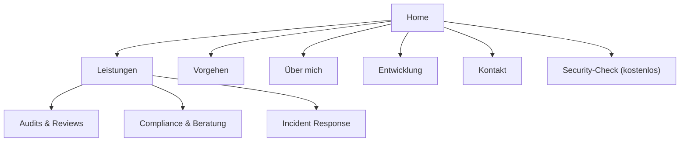
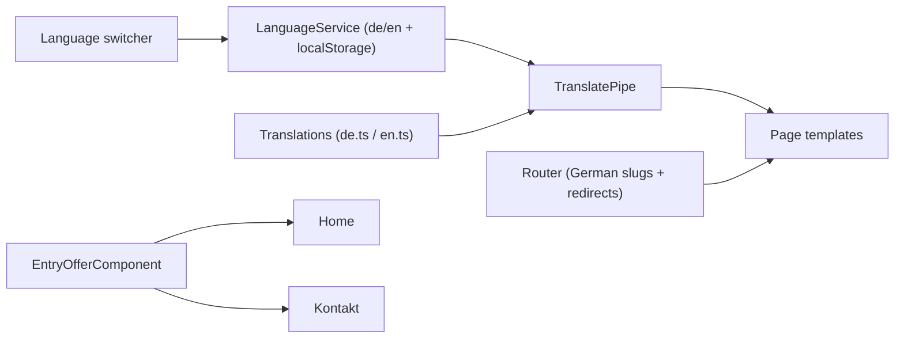

# Security Repositioning - Plan

## Goal Capsule

- **Objective:** Reposition thomastritscher.com from a software-engineer portfolio into a client-facing cyber-security presence led by Audit & Review services, while keeping software development as a smaller, clearly separated area.
- **Product authority:** Site owner (Thomas Tritscher). Decisions confirmed through brainstorm dialogue on 2026-11-11.
- **Open blockers:** None.
- **Execution profile:** `code` — full restructure of an existing Angular site, not a greenfield build.
- **Stop conditions:** Stop and report if the runtime i18n approach cannot render both languages in one build, or if a required security asset cannot be licensed.
- **Tail ownership:** The LFG pipeline owns simplify, review, browser test, commit/push/PR, and CI watch after implementation.

## Product Contract

### Summary

Rebuild the site around security audits for prospective clients: Audits & Reviews lead, Compliance & Beratung and Incident Response support them, and a low-threshold entry offer replaces the generic contact CTA. Software development survives as a smaller, separate area, and the whole public site becomes bilingual (DE/EN) with new security-appropriate visuals.

### Problem Frame

The site currently positions Thomas Tritscher exclusively as a Software Engineer: the homepage intro, the `/person` bio, the skills catalogue and all eight projects are developer-framed, and the page title is "Thomas Tritscher Dev". There is no security content anywhere in `src`. The site therefore cannot serve the intended next step — winning clients for security audits — and would actively mislead a prospective client about what is being offered.

### Key Decisions

- **Security leads, development supports.** The site's identity is a security auditor with a developer background; the dev area is retained only as a smaller separate section. (Governs R4, R12, R13.)
- **Audits & Reviews is the primary service; Compliance & Beratung and Incident Response are secondary.** Pentest, hardening and awareness are deliberately not offered. (Governs R5, R8, R9.)
- **A methodology page replaces references/cases.** With no security track record yet, the site explains how an audit runs instead of claiming case studies. (Governs R10, R11.)
- **A low-threshold entry offer is the primary call to action**: a free automated quick security check with a short result report, with the full audit paid. (Governs R6, R18, R19.)
- **Complete bilingual public site (DE/EN) with a language switcher.** (Governs R14, R15.)
- **Full information-architecture restructure with new security imagery**, rather than reskinning the existing pages. The unused 3D-morph-hero plan is discarded. (Governs R1, R2, R17.)

### Requirements

**Structure & navigation**

- R1. The public site is organised into these top-level pages: Home, Leistungen, Vorgehen, Über mich, Entwicklung, Kontakt (with English equivalents).
- R2. Every old route maps cleanly to a new page or redirects, so no existing link or nav entry dead-ends.
- R3. Global navigation reflects the new structure and is shown in the active language.

**Homepage**

- R4. The homepage leads with the security-auditor positioning and Audits & Reviews, not with software engineering.
- R5. The homepage presents the three services with Audits & Reviews visibly primary.
- R6. The homepage ends in the low-threshold entry offer as its main call to action.
- R7. The old "I'm a Software Engineer" framing is removed from the homepage intro and from the primary hero.

**Services**

- R8. The Leistungen page details Audits & Reviews (primary), Compliance & Beratung and Incident Response, each with what the client gets.
- R9. Pentest, hardening and awareness training are not presented as offered services.

**Vorgehen (methodology)**

- R10. The Vorgehen page explains how an audit runs end to end, what the client receives, and includes an example scenario.
- R11. The site presents no fabricated security case studies or client references.

**Über mich & Entwicklung**

- R12. The Über mich page tells a security-first story, uses the software-engineering background as credibility, and mentions the ongoing training only briefly.
- R13. The Entwicklung area is visibly secondary and retains the existing software projects and developer skills content.

**Bilingual**

- R14. All public copy is available in German and English.
- R15. A site-wide language switcher is present, and the chosen language persists across navigation and return visits.
- R16. Imprint and data-protection pages remain available and legally valid throughout the restructure.

**Visuals**

- R17. Coding-oriented imagery is replaced with security-appropriate visuals across hero, key images and icons, including a new hero asset that no longer depicts a code overlay.

**Entry offer & conversion**

- R18. The site surfaces the free quick-check entry offer on the homepage and Kontakt page and captures a request with the target URL and contact details; the scan and its report are fulfilled outside this application.
- R19. Wherever the entry offer appears, the page states that the quick check is free while the full audit is paid.

**Metadata & branding**

- R20. Page title and meta description reflect the security positioning rather than "Dev".
- R21. Branding, domain, contact address and social links stay consistent across all pages.

### Key Flows

- F1. Prospective-client journey
  - **Trigger:** A prospective client lands on the homepage.
  - **Steps:** Sees the security positioning and services → opens Leistungen for detail → reads Vorgehen to judge the method → optionally checks Über mich → reaches the entry offer or Kontakt.
  - **Outcome:** The visitor can tell what is offered and how to start without encountering software-engineering framing.
  - **Covers:** R4, R5, R6, R8, R10, R12, R18.

### Acceptance Examples

- AE1. Language persists
  - **Covers R14, R15.**
  - **Given** a visitor selects English.
  - **When** they navigate between pages or return later.
  - **Then** all public pages render in English and the selection remains active.
- AE2. Entry-offer boundary is explicit
  - **Covers R19.**
  - **Given** a visitor reads the entry offer.
  - **When** they consider whether to take it up.
  - **Then** the page states that the free check is an automated quick scan with a short report and that the full audit is paid.

### Success Criteria

- Qualified client inquiries arrive through the entry offer or Kontakt form.
- A first-time visitor can identify the site as a security-audit offering from the homepage alone.
- No public page still leads with Software Engineer framing; the Entwicklung area reads as clearly secondary.
- Both languages are complete, with no untranslated placeholder copy.

### Scope Boundaries

**Deferred for later**

- Real security case studies and client references — to be added after the first audits exist.
- Further services such as Pentest, hardening or awareness training.

**Outside this product's identity**

- The discarded 3D-morph-hero visual from `docs/plans/2026-08-24-001-feat-3d-morph-hero-visual-plan.md`.
- A job-application portfolio framing; the site speaks to clients, not recruiters.

### Dependencies / Assumptions

- New security imagery must be sourced or created; no security assets exist today.
- The free quick check is fulfilled by an external process; the site only captures and forwards the request.
- Bilingual delivery requires authoring a full German and English copy set; no i18n infrastructure exists today.
- Existing project images and developer skill content are reused inside the Entwicklung area.

### Outstanding Questions

None blocking. Q1–Q3 from the brainstorm are resolved in the Planning Contract (KTD2, KTD1, KTD5).

**Deferred to Planning**

- Q4. The exact title and provider of the ongoing cyber-security training; U7 uses the confirmed title when supplied and otherwise names the training generically.

### Sources / Research

- Current homepage and section content: `src/app/main/main.component.html`, `src/app/sections/sections.component.html`
- Existing pages: `src/app/person/person.component.html`, `src/app/skills/skills.component.html`, `src/app/projects/projects.component.html`, `src/app/contact/contact.component.html`, `src/app/h-nav/h-nav.component.html`
- Routing: `src/app/app-routing.module.ts`
- Metadata: `src/index.html`
- Discarded prior visual plan: `docs/plans/2026-08-24-001-feat-3d-morph-hero-visual-plan.md`

---

## Planning Contract

**Product Contract preservation:** changed: R18 — clarified that the site surfaces the offer and captures the request while the scan is fulfilled externally; the CTA label was aligned. Deferred Q4 added. Q1–Q3 resolved below.

### Key Technical Decisions

- KTD1. Use a runtime translation service with typed dictionaries, not a build-time locale split. One build serves both languages, so the switcher changes copy without a reload or a second build target. The pipe takes the active language as an argument (or is marked impure) so template copy re-renders on switch. Cite R14, R15.
- KTD2. Keep one URL per page with German slugs and treat language as runtime state, not a URL prefix. Routes: `/`, `/leistungen`, `/vorgehen`, `/ueber-mich`, `/entwicklung`, `/kontakt`. Old `/projects` and `/skills` redirect to `/entwicklung`, `/person` to `/ueber-mich`, and `/contact` to `/kontakt`. English content is not separately addressable in v1; locale URLs and `hreflang` are deferred. Cite R1, R2, R3.
- KTD3. Hold all public copy in typed translation dictionaries keyed by page and section. Templates read keys through a pipe instead of hardcoding prose. Cite R14, R20.
- KTD4. Recast the existing page components instead of rebuilding the app shell. `PersonComponent` becomes Über mich, `ContactComponent` becomes Kontakt, and the project and skill markup moves into a new Entwicklung page. Cite R13, R21.
- KTD5. Source security visuals from license-free stock and inline SVG, stored under `src/assets/img/security/` and `src/assets/icons/security/`. Art direction: restrained and abstract; avoid hooded hackers, binary rain, padlocks, and generic matrix imagery. Cite R17.
- KTD6. Build one shared entry-offer component that states the free-versus-paid boundary, and reuse it on the homepage and Kontakt page. Cite R6, R18, R19.
- KTD7. The quick check is fulfilled outside this Angular app. The site captures the request (target URL, contact, consent) and forwards it; no scanner, backend, or report generator is built in this repo. Cite R18.

### High-Level Technical Design

The language service owns the active language and persisted choice. The pipe reads dictionaries. Page components are language-agnostic.

### Assumptions

- The existing Angular-animation-driven page motion and layout chrome stay; this plan changes content, IA, visuals, and language handling, not the animation system. The stale `gsap` script entry is removed from the `angular.json` test options because `gsap` is not installed.
- No CMS is introduced. Copy lives in the repository dictionaries and is edited in code.
- The site owner approves the German and English copy before launch.
- The exact training title is supplied by the owner; until then U7 names the cyber-security training generically.
- Existing domain, contact address and social links remain unchanged.
- `ChangeDetectionStrategy.Eager`, `standalone: false`, and the NgModule declaration pattern stay as-is to match the existing codebase.

### Implementation Constraints

- Angular 22 with NgModule declarations in `src/app/app.module.ts`.
- Tests use Jasmine/Karma via `src/test.ts` and `karma.conf.js`.
- Interface copy is authored in both German and English; no machine translation at runtime.

### Sequencing

U1 and U2 establish infrastructure and shells. U3 supplies copy. U4–U8 fill pages. U9 finishes visuals, metadata and Kontakt. U10 wires the entry-offer form after the offer surfaces exist.

---

## Implementation Units

### U1. Bilingual foundation

- **Goal:** Add the language state, translation pipe, dictionaries scaffold, and language switcher.
- **Requirements:** R14, R15
- **Dependencies:** None
- **Files:** `src/app/i18n/language.service.ts`, `src/app/i18n/language.service.spec.ts`, `src/app/i18n/translate.pipe.ts`, `src/app/i18n/translate.pipe.spec.ts`, `src/app/i18n/translations.types.ts`, `src/app/i18n/language-switcher/language-switcher.component.ts`, `src/app/i18n/language-switcher/language-switcher.component.html`, `src/app/i18n/language-switcher/language-switcher.component.scss`, `src/app/i18n/language-switcher/language-switcher.component.spec.ts`, `src/app/app.module.ts`, `angular.json`
- **Approach:**
  - Service holds `activeLanguage: 'de' | 'en'`, defaults to German, reads and writes `localStorage` inside `try/catch`.
  - Pipe accepts the active language as an argument (or is impure) so templates re-render on switch; it returns the key when a dictionary entry is missing.
  - Switcher exposes two buttons with `aria-pressed`, active styling and keyboard focus, and updates `document.documentElement.lang`.
  - Remove the stale `gsap` script from the `angular.json` test options.
- **Patterns to follow:** Existing service style in `src/app/services/`.
- **Test scenarios:**
  - Happy path: service defaults to `de` when storage is empty.
  - Happy path: switching to `en` updates the active language and persists it.
  - Happy path: pipe returns the German string for a known key in `de`.
  - Edge case: pipe returns the key when the dictionary entry is missing.
  - Edge case: stored invalid language falls back to `de`.
  - Error path: throwing storage falls back to in-memory German without breaking bootstrap.
  - Integration: rendered template re-renders copy when the language switches.
  - Accessibility: active button exposes `aria-pressed="true"` and `html[lang]` changes.
  - **Covers AE1.** Reloading with a stored `en` preference renders English.
- **Verification:** Build compiles; the new specs pass.

### U2. Information architecture and routing

- **Goal:** Add the new page shells, routes, redirects, and updated navigation.
- **Requirements:** R1, R2, R3
- **Dependencies:** U1
- **Files:** `src/app/app-routing.module.ts`, `src/app/app.module.ts`, `src/app/leistungen/leistungen.component.ts`, `src/app/leistungen/leistungen.component.html`, `src/app/leistungen/leistungen.component.scss`, `src/app/leistungen/leistungen.component.spec.ts`, `src/app/methodology/methodology.component.ts`, `src/app/methodology/methodology.component.html`, `src/app/methodology/methodology.component.scss`, `src/app/methodology/methodology.component.spec.ts`, `src/app/development/development.component.ts`, `src/app/development/development.component.html`, `src/app/development/development.component.scss`, `src/app/development/development.component.spec.ts`, `src/app/h-nav/h-nav.component.ts`, `src/app/h-nav/h-nav.component.html`, `src/app/h-nav/h-nav.component.scss`, `src/app/outer-frame/outer-frame.component.ts`, `src/app/outer-frame/outer-frame.component.html`, `src/app/outer-frame/outer-frame.component.scss`
- **Approach:**
  - Routes: `/` Main, `/leistungen` Leistungen, `/vorgehen` Methodology, `/ueber-mich` Person, `/entwicklung` Development, `/kontakt` Contact, plus existing legal routes.
  - Redirect `/projects` and `/skills` to `/entwicklung`; `/person` to `/ueber-mich`; `/contact` to `/kontakt`.
  - Update both navigation surfaces: `h-nav` and the `outer-frame` overlay menu. Point both at the canonical routes and translation keys.
  - Navigation labels resolve once U3 populates the dictionaries.
- **Test scenarios:**
  - Happy path: each new path renders its component.
  - Happy path: `/projects`, `/skills`, `/person`, and `/contact` redirect to the new paths.
  - Edge case: unknown path keeps the existing fallback behavior.
  - Integration: nav links target the canonical paths.
- **Verification:** Build compiles; route specs pass; manual route check shows no dead links.

### U3. Bilingual content source

- **Goal:** Populate German and English dictionaries for every public page and shared label.
- **Requirements:** R5, R8, R10, R12, R14, R16, R19, R20
- **Dependencies:** U1
- **Files:** `src/app/i18n/translations.types.ts`, `src/app/i18n/translations.de.ts`, `src/app/i18n/translations.en.ts`, `src/app/i18n/translations.spec.ts`, `src/app/imprint/imprint.component.html`, `src/app/data-protection/data-protection.component.html`
- **Approach:**
  - Group keys by page and section.
  - Type the dictionary shape so a missing language key fails compilation.
  - Cover nav, home, services, methodology, about, development, contact, metadata, and the imprint and data-protection pages.
- **Test scenarios:**
  - Happy path: German and English dictionaries expose the same key set.
  - Edge case: a required top-level page key exists in both languages.
  - **Covers AE2.** The entry-offer strings state the free-versus-paid boundary in both languages.
- **Verification:** Type-check and spec pass; key parity is asserted.

### U4. Homepage security rebuild

- **Goal:** Rebuild the homepage around the security positioning, three services, and the entry offer.
- **Requirements:** R4, R5, R6, R7, R17, R18, R19
- **Dependencies:** U1, U3
- **Files:** `src/app/main/main.component.html`, `src/app/main/main.component.ts`, `src/app/main/main.component.scss`, `src/app/main/main.component.spec.ts`, `src/app/sections/sections.component.html`, `src/app/sections/sections.component.ts`, `src/app/sections/sections.component.scss`, `src/app/sections/sections.component.spec.ts`, `src/app/services/layer-change.service.ts`, `src/app/shared/entry-offer/entry-offer.component.ts`, `src/app/shared/entry-offer/entry-offer.component.html`, `src/app/shared/entry-offer/entry-offer.component.scss`, `src/app/shared/entry-offer/entry-offer.component.spec.ts`, `src/app/app.module.ts`, `src/assets/img/security/`
- **Approach:**
  - Replace the hero image and alt text first; this unit owns the hero asset and the R17 hero outcome.
  - Keep the five-section step sequence: hero, positioning intro, services summary, method summary, entry offer. Update `layer-change.service.ts` so the transitions match the new section count.
  - Replace the "a Software Engineer" intro with the audit positioning.
  - Replace the Academy and "I code a lot!" sections with the services and method summaries.
  - Make Audits & Reviews visibly primary: lead block, larger heading, deeper copy; Compliance and Incident Response as secondary cards.
  - End on the shared entry offer.
- **Test scenarios:**
  - Happy path: homepage renders audit-first heading in the active language.
  - Happy path: all three services appear with Audits primary.
  - Happy path: hero renders the new security asset with descriptive alt text.
  - **Covers AE2.** Entry offer states free quick check and paid audit.
  - Edge case: switching language re-renders all homepage copy.
  - Negative: no "Software Engineer" heading remains on the homepage.
- **Verification:** Build compiles; spec passes; manual check of homepage in both languages.

### U5. Leistungen page

- **Goal:** Detail the three services with client-facing outcomes.
- **Requirements:** R5, R8, R9
- **Dependencies:** U2, U3
- **Files:** `src/app/leistungen/leistungen.component.html`, `src/app/leistungen/leistungen.component.ts`, `src/app/leistungen/leistungen.component.scss`, `src/app/leistungen/leistungen.component.spec.ts`
- **Approach:**
  - One section per service, Audits & Reviews first.
  - Give Audits & Reviews a dedicated lead block with deeper copy; render Compliance and Incident Response as secondary sections.
  - Each section states what the client receives.
  - Do not list Pentest, hardening, or awareness.
- **Test scenarios:**
  - Happy path: three service sections render in order.
  - Happy path: each section carries an outcome line.
  - Negative: page contains no Pentest, hardening, or awareness offering.
  - Edge case: language switch updates all service copy.
- **Verification:** Build compiles; spec passes; manual copy check in both languages.

### U6. Vorgehen page

- **Goal:** Replace case studies with an end-to-end audit method and an example scenario.
- **Requirements:** R10, R11
- **Dependencies:** U2, U3
- **Files:** `src/app/methodology/methodology.component.html`, `src/app/methodology/methodology.component.ts`, `src/app/methodology/methodology.component.scss`, `src/app/methodology/methodology.component.spec.ts`
- **Approach:**
  - Render the audit phases in order: intake, scope, execution, report, follow-up.
  - Include a labelled example scenario.
  - Keep the wording clearly illustrative; no client claims.
- **Test scenarios:**
  - Happy path: audit phases render in order.
  - Happy path: example scenario is labelled as an example.
  - Negative: no client name or "reference" claim appears.
  - Edge case: language switch updates all method copy.
- **Verification:** Build compiles; spec passes; manual check in both languages.

### U7. Über mich page

- **Goal:** Recast the person page as a security-first biography.
- **Requirements:** R12, R16
- **Dependencies:** U2, U3
- **Files:** `src/app/person/person.component.html`, `src/app/person/person.component.ts`, `src/app/person/person.component.scss`, `src/app/person/person.component.spec.ts`
- **Approach:**
  - Lead with the security-auditor identity.
  - Present software-engineering experience as credibility.
  - Mention the ongoing training in one short line, using the owner-confirmed title when supplied and a generic cyber-security training name otherwise.
  - Keep legal links reachable.
- **Test scenarios:**
  - Happy path: biography leads with security, not software engineering.
  - Happy path: training is mentioned once.
  - Edge case: language switch updates the biography.
  - Integration: imprint and data-protection links still resolve.
- **Verification:** Build compiles; spec passes; manual read in both languages.

### U8. Entwicklung page

- **Goal:** Consolidate the existing projects and developer skills into one visibly secondary area.
- **Requirements:** R13, R16
- **Dependencies:** U2, U3
- **Files:** `src/app/development/development.component.html`, `src/app/development/development.component.ts`, `src/app/development/development.component.scss`, `src/app/development/development.component.spec.ts`, `src/app/projects/projects.component.html`, `src/app/projects/projects.component.ts`, `src/app/projects/projects.component.scss`, `src/app/projects/projects.component.spec.ts`, `src/app/skills/skills.component.html`, `src/app/skills/skills.component.ts`, `src/app/skills/skills.component.scss`, `src/app/skills/skills.component.spec.ts`
- **Approach:**
  - Move the eight project entries and the six skill groups into the Entwicklung page.
  - Keep one `outer-frame` on the Entwicklung page so the imprint and data-protection links remain.
  - Remove duplicated page chrome (own cursor, transition, nested outer frame) from the moved markup.
  - Delete `ProjectsComponent` and `SkillsComponent` after extraction; do not leave unused wrappers.
  - Label the area as the developer background, not the main offer.
  - Keep Entwicklung in the global navigation but visually muted relative to the security pages.
- **Test scenarios:**
  - Happy path: all eight projects render.
  - Happy path: all six skill groups render.
  - Happy path: the imprint and data-protection links resolve from Entwicklung.
  - Edge case: Entwicklung is reachable from the global navigation and reads as secondary.
  - Edge case: language switch updates headings and labels.
- **Verification:** Build compiles; spec passes; manual check that no duplicate chrome remains.

### U9. Visuals, metadata and Kontakt

- **Goal:** Replace coding imagery, add security visuals, update page metadata, and finish the Kontakt page with the entry offer.
- **Requirements:** R6, R17, R18, R19, R20, R21
- **Dependencies:** U3, U4
- **Files:** `src/index.html`, `src/app/contact/contact.component.html`, `src/app/contact/contact.component.ts`, `src/app/contact/contact.component.scss`, `src/app/contact/contact.component.spec.ts`, `src/app/outer-frame/outer-frame.component.ts`, `src/app/outer-frame/outer-frame.component.html`, `src/app/outer-frame/outer-frame.component.scss`, `src/assets/img/security/`, `src/assets/icons/security/`
- **Approach:**
  - Add security-themed supporting images and icons; keep the hero change in U4.
  - Follow the KTD5 art direction; avoid hooded hackers, binary rain, padlocks, and matrix imagery.
  - Replace the `outer-frame` "Software Engineer" tagline with the security positioning from the dictionaries.
  - Update the page title and meta description to the security positioning.
  - Reuse the entry-offer component on Kontakt.
  - Keep the logo and brand colours.
  - Give every new image descriptive alt text and every icon an accessible label or `aria-hidden`.
- **Test scenarios:**
  - Happy path: supporting security images load.
  - Happy path: Kontakt renders the entry offer.
  - Happy path: the header tagline shows the security positioning in the active language.
  - Happy path: page title contains the security positioning, not "Dev".
  - Edge case: missing image falls back to the current layout without breaking.
  - Accessibility: new images carry alt text and decorative icons are hidden from assistive tech.
  - **Covers AE2.** Kontakt states free quick check and paid audit.
- **Verification:** Build compiles; spec passes; manual check of image loading and title.

### U10. Entry-offer request form

- **Goal:** Implement the request capture behind the entry offer so the CTA is not dead copy.
- **Requirements:** R6, R18, R19
- **Dependencies:** U4, U9
- **Files:** `src/app/shared/entry-offer/entry-offer.component.ts`, `src/app/shared/entry-offer/entry-offer.component.html`, `src/app/shared/entry-offer/entry-offer.component.scss`, `src/app/shared/entry-offer/entry-offer.component.spec.ts`
- **Approach:**
  - Form fields: target URL, contact email, consent checkbox.
  - Submit composes a request through the existing contact channel (`mailto:` to the site address) or a configurable endpoint; the scan is fulfilled externally per KTD7.
  - Render loading, success, validation-error, and submit-failure states.
  - State the free-versus-paid boundary next to the form (R19).
- **Test scenarios:**
  - Happy path: valid input builds a request and shows the success state.
  - Edge case: missing or malformed URL/email blocks submit with a field error.
  - Error path: submission failure shows a retry message and preserves input.
  - **Covers AE2.** Form states free quick check and paid audit.
  - Edge case: language switch updates labels and messages.
- **Verification:** Build compiles; spec passes; manual submit check on Home and Kontakt.

---

## Verification Contract

- Build: `NODE_OPTIONS=--openssl-legacy-provider npm run build` — must succeed.
- Unit tests: `NODE_OPTIONS=--openssl-legacy-provider npm test -- --watch=false --browsers=ChromeHeadless` — all specs pass.
- Lint: `npm run lint` — run when available. Angular 22 may not support the checked-in TSLint setup; if it fails for tooling reasons, record the failure and rely on build plus tests.
- Manual smoke: `npm start`, then check each route, both languages, the four redirects, and the entry offer on Home and Kontakt.
- Manual accessibility check: keyboard reachability, visible focus, `html[lang]` updates, `aria-pressed` on the switcher, and alt text on new images.
- Manual responsive check at 375px, 768px, and 1280px for the new pages and navigation.

---

## Definition of Done

- All nine units complete with their test scenarios passing. U10 is included, so the plan has ten units total.
- Build and test gates green; the stale `gsap` test script is removed so the test target resolves.
- Both languages complete, with no untranslated placeholder copy, and the site owner has approved both.
- The entry-offer CTA is functional: submitting the form produces a request and a clear success or error state.
- All old routes resolve to the new pages or redirect.
- No page leads with Software Engineer framing; the global tagline is security-first and Entwicklung is visibly secondary.
- Page title and meta description reflect the security positioning.
- Keyboard navigation, focus visibility, `html[lang]`, and image alt text pass the accessibility check.
- Abandoned or experimental code from the implementation is removed from the diff.
- No three.js or 3D hero code is introduced.

